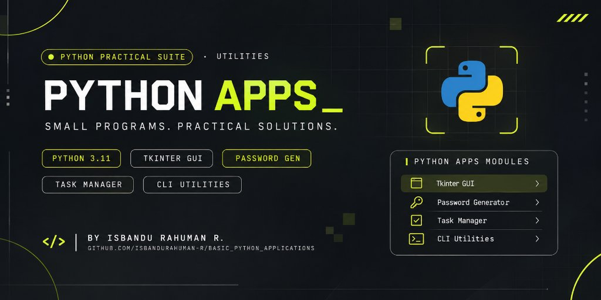
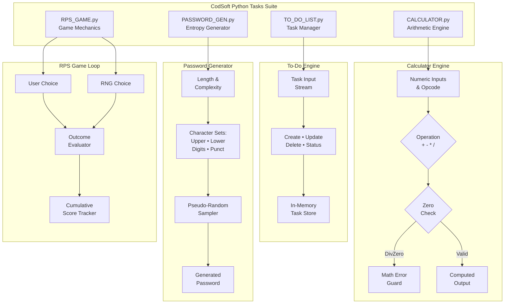

<p align="center">
  
</p>

# ◈ CodSoft Python Programming Tasks

[](https://github.com/ISBANDURAHUMAN-R/CODSOFT_taskno_PYTHON/actions/workflows/ci.yml)

## ◆ About the Project
This repository contains a collection of foundational Python projects completed during the CodSoft Python Programming Internship. The projects encompass daily productivity tools, mathematical utilities, cybersecurity generators, and game logic scripts designed to reinforce core Python fundamentals.

## ❖ Key Features
- To-Do List (`TO_DO_LIST.py`): Console task manager supporting task creation, updating, deletion, and status tracking.
- Calculator (`CALCULATOR.py`): Terminal arithmetic calculator executing addition, subtraction, multiplication, and division with error handling.
- Password Generator (`PASSWORD_GENERATOR.py`): Configurable password generation utility creating secure character strings based on user-specified length and complexity.
- Rock Paper Scissors (`ROCK_PAPER_SCISSOR.py`): Turn-based game engine against computer randomness with scorekeeping and rematch loops.

## ◆ System Architecture


## ⬢ Technologies Used
- Python 3
- Python Standard Library (`random`, `string`)

## § Requirements
- Python 3.8 or higher

## ▲ Installation & Execution
```bash
# Run individual task applications:
python TO_DO_LIST.py
python CALCULATOR.py
python PASSWORD_GENERATOR.py
python ROCK_PAPER_SCISSOR.py
```

## ※ Developer
Developer: ISBANDU RAHUMAN R  
GitHub: https://github.com/ISBANDURAHUMAN-R
